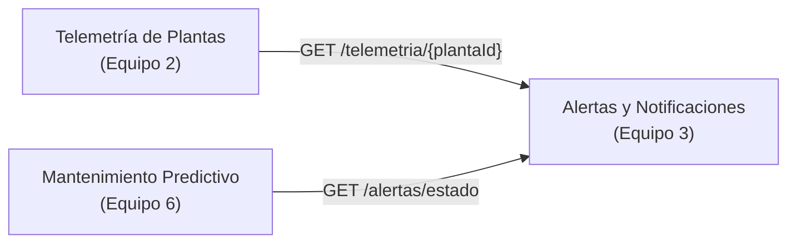

# Voltrix Energy · Alertas y Notificaciones

Servicio del **Equipo 3** en la plataforma de monitoreo distribuido de Voltrix Energy. Evalúa lecturas de telemetría contra umbrales operativos y registra alertas **sin duplicados ni pérdidas**, con control explícito de concurrencia sobre recursos compartidos.

Proyecto del curso **750023C Infraestructuras Paralelas y Distribuidas**, Universidad del Valle, 2026-2.
Profesor: Manuel Alejandro Pastrana Pardo, PhD.

## Qué hace

- Recibe lotes de lecturas (en el cuerpo de la petición o traídas desde Telemetría de Plantas) y las evalúa en paralelo con N workers.
- Detecta sobrecalentamiento de baterías, caída de generación de paneles y viento fuera de rango en turbinas.
- Protege los recursos compartidos (contadores por activo, registro de alertas y cola de notificaciones) con locks por franja y una cola thread-safe.
- Entre réplicas, evita duplicados con un índice único parcial en PostgreSQL y `INSERT ... ON CONFLICT`.

## Lugar en el sistema



## API

Contrato completo: [`openapi.yaml`](openapi.yaml) (OpenAPI 3.0.3).

| Método y ruta | Descripción |
| --- | --- |
| `POST /alertas` | Evalúa un lote de lecturas y registra o actualiza alertas. Admite `?modo=secuencial\|concurrente&workers=N` para el benchmark. |
| `GET /alertas/estado` | Alertas vigentes con totales por severidad y por planta. |
| `GET /health` | Estado del servicio, la base de datos y la conexión con Telemetría. |

## Documentación

- Diseño de la solución: [`docs/diseno.md`](docs/diseno.md) (también en [Word](docs/diseno.docx)).

## Stack

Python 3.12 · FastAPI · Uvicorn · `concurrent.futures` / `threading` · PostgreSQL 16 · Docker y docker-compose (EC2) · Kubernetes sobre Floci EKS.

## Estructura del repositorio

```text
.
├── openapi.yaml        # Contrato de la API
├── docs/               # Diseño y evidencia
├── app/                # Código del servicio (Avance 1)
├── bench/              # Benchmark secuencial vs concurrente (Avance 2)
├── deploy/
│   ├── compose/        # docker-compose para EC2
│   ├── k8s/            # Manifiestos para Floci EKS
│   └── iac/            # Infraestructura como código
└── README.md
```

## Cómo ejecutar

Pendiente para el Avance 1 (esqueleto con docker-compose y datos de ejemplo según el contrato).

## Cronograma

| Fecha | Entrega | Estado |
| --- | --- | --- |
| 19 nov 2026 | Diseño y contrato OpenAPI | Entregado |
| 26 nov 2026 | Avance 1: esqueleto en EC2 y clúster en Floci EKS | Pendiente |
| 3 dic 2026 | Avance 2: versiones secuencial y concurrente, benchmark, 2 réplicas, consumo real | Pendiente |
| 10 dic 2026 | Entrega final y sustentación | Pendiente |

## Equipo 3

| Integrante | GitHub |
| --- | --- |
| Andrés Gerardo González Rosero | [@Inmemorialake](https://github.com/Inmemorialake) |
| Por completar | |
| Por completar | |
| Por completar | |
| Por completar | |
