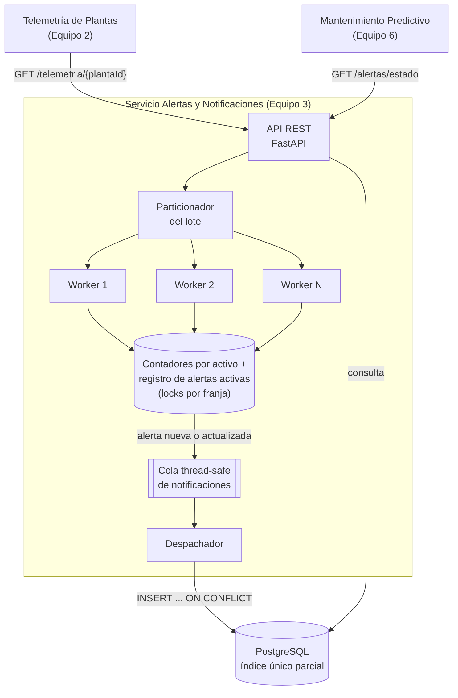
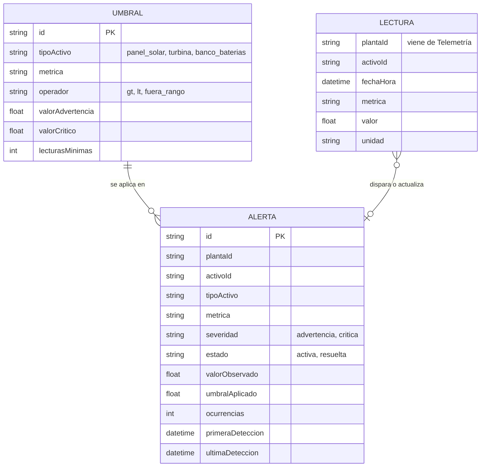
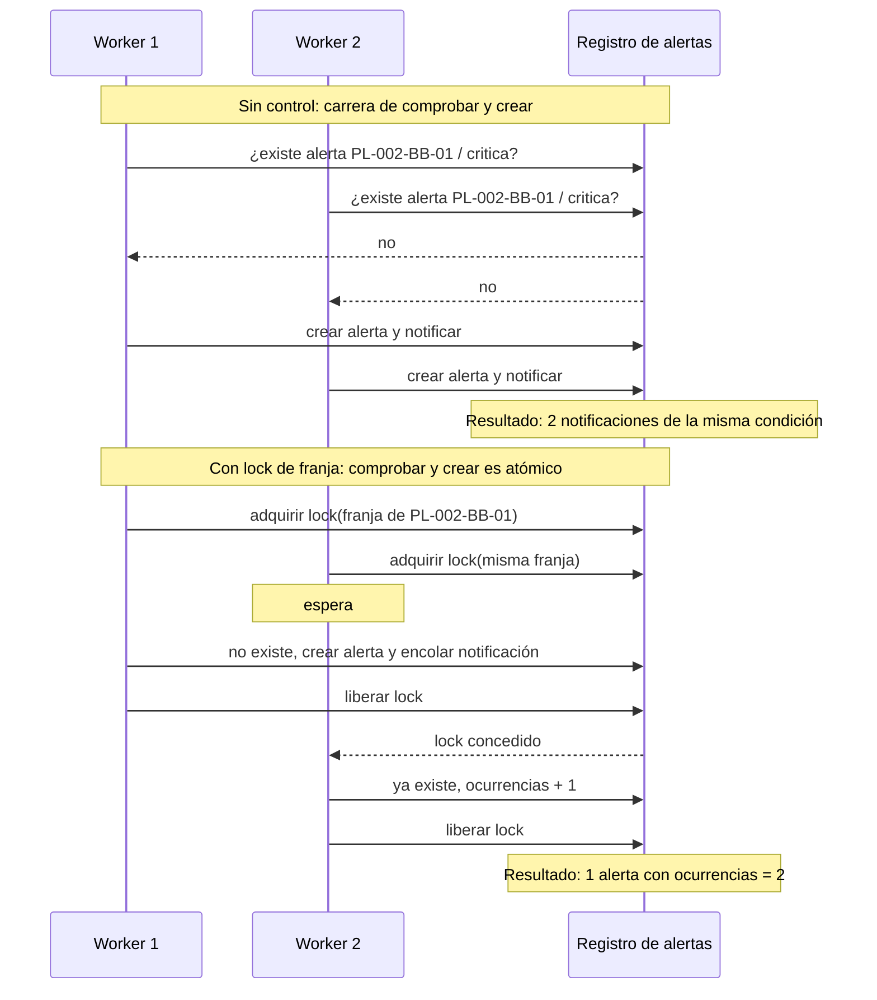

# Diseño: servicio de Alertas y Notificaciones

**Equipo 3 · Voltrix Energy**\
Curso 750023C Infraestructuras Paralelas y Distribuidas, Univalle, 2026-2\
Profesor: Manuel Alejandro Pastrana Pardo, PhD

| Integrante | Código | Correo | Rol en la célula |
| --- | --- | --- | --- |
| Andrés Gerardo González Rosero | 202416541 | andres.gerardo.gonzalez@correounivalle.edu.co | Por definir |
| Juan David Guar | 202341909 | juan.guar@correounivalle.edu.co | Por definir |
| Sarahy Gisselle Caicedo Betancourth | 202610315 | sarahy.caicedo@correounivalle.edu.co | Por definir |
| Verónica Andreina Granados López | 202123263 | veronica.granados@correounivalle.edu.co | Por definir |
| Freddy Alexander Melo Buitrago | 202125498 | freddy.melo@correounivalle.edu.co | Por definir |

El contrato vigente es [`openapi.yaml`](../openapi.yaml), que sigue la plantilla común de Voltrix Energy (Equipo 1, hoja Coordinacion_Voltrix). Si este documento y el contrato difieren, manda el contrato.

| Versión | Fecha | Cambio |
| --- | --- | --- |
| 1.0 | 19 nov 2026 | Diseño y contrato iniciales |
| 1.1 | 26 nov 2026 | Alineado con la plantilla común y con el contrato de Telemetría de Plantas (Equipo 2): `modo=paralelo`, puerto 8080, 429 por sobrecarga, IDs del Inventario, valores en minúscula, forma de la lectura del Equipo 2 y `resumenPorActivo` para el Equipo 6 |

## 1. Responsabilidad del servicio

Alertas y Notificaciones evalúa las lecturas de telemetría contra umbrales operativos y registra las alertas de condiciones críticas o urgentes, sin duplicarlas ni perderlas. Es un servicio de entidad: su dato principal es la alerta y su estado.

- **Consume:** Telemetría de Plantas (Equipo 2), con `GET /telemetria/{plantaId}` y los filtros `desde`, `hasta` y `tipoActivo`.
- **Lo consume:** Mantenimiento Predictivo (Equipo 6), que lee `GET /alertas/estado` y toma de `resumenPorActivo` los conteos `alertasActivas` y `alertasCriticas` de cada activo.
- **Condiciones que detecta** (las del caso): sobrecalentamiento de bancos de baterías, caída de generación de paneles solares y viento fuera del rango operativo de las turbinas.
- **Problema que corrige:** el sistema actual produjo notificaciones duplicadas y perdió una alerta crítica por una condición de carrera entre dos procesos que escribían el mismo registro de estado. Este servicio debe demostrar que ese caso ya no ocurre.

Fuera de alcance: el envío real de correos o SMS. La notificación se registra y su despacho se simula con una latencia artificial, porque lo evaluado es el control de concurrencia.

## 2. Arquitectura del servicio

Una petición `POST /alertas` recibe un lote, lo parte entre N workers que evalúan umbrales en paralelo y escriben en un registro compartido protegido por locks. Las alertas nuevas o actualizadas pasan por una cola thread-safe a un despachador, que las persiste en PostgreSQL.



| Componente | Tecnología | Función |
| --- | --- | --- |
| API REST | Python 3.12, FastAPI, Uvicorn (puerto 8080) | Expone los endpoints del contrato, valida entradas, agrega `X-Request-Id` y registra `X-Equipo-Consumidor` |
| Cliente de Telemetría | httpx, URL inyectada por variable de entorno | Trae las lecturas de una planta por `tipoActivo`, paginando con `X-Next-Offset` |
| Evaluador | `concurrent.futures.ThreadPoolExecutor` | Parte el lote en N bloques y evalúa umbrales en paralelo |
| Registro compartido | `dict` en memoria + `threading.Lock` por franja | Contadores de violaciones por activo y alertas activas |
| Cola de notificaciones | `queue.Queue(maxsize)` | Desacopla la detección del despacho; si se llena, la API responde 429 con `Retry-After` |
| Despachador | Hilos consumidores | Simula el envío y persiste con `INSERT ... ON CONFLICT` |
| Base de datos | PostgreSQL 16 (alpine) | Umbrales y alertas; índice único parcial evita duplicados entre réplicas |

## 3. Modelo de datos y umbrales

El servicio guarda dos tablas: `umbral` (la regla) y `alerta` (el estado vigente de cada condición detectada). La clave de deduplicación de una alerta es `(activo_id, metrica, severidad)` mientras su estado sea `activa`, y la protege un índice único parcial.



`Lectura` no se guarda en este servicio: llega en el lote o desde Telemetría, se evalúa y se descarta. Tiene la forma de `LecturaTelemetria` del Equipo 2, que no incluye el tipo de activo. Por eso el servicio consulta a Telemetría filtrando por `tipoActivo`, o lo deduce del segmento del ID del Inventario: `PS` panel_solar, `TB` turbina, `BB` banco_baterias (por ejemplo, `PL-002-BB-01`).

Umbrales iniciales. Son supuestos del equipo: se cargan desde un ConfigMap y se pueden ajustar sin recompilar.

| Tipo de activo | Métrica que llega | Métrica evaluada | Advertencia | Crítica |
| --- | --- | --- | --- | --- |
| banco_baterias | `temperatura` (°C) | `temperatura` | > 40 | > 45 |
| panel_solar | `potencia` (W) | `caida_potencia` (%) | > 20 | > 40 |
| turbina | `velocidad_viento` (m/s) | `velocidad_viento` | > 20 | < 3 o > 25 |

Telemetría entrega la potencia del panel en W, no la caída. La caída se calcula comparando cada lectura con la mediana de potencia del mismo panel en la ventana evaluada.

Una alerta se crea cuando un activo acumula `lecturasMinimas` lecturas en violación dentro del lote evaluado (por defecto 3). Esto filtra picos aislados y no depende del orden en que los workers procesen las lecturas. El contador por activo es el recurso compartido que se protege en la sección 5.

## 4. Contrato de la API

El contrato completo está en `openapi.yaml` (OpenAPI 3.0.3, validado; también en `openapi.json`) y se publica con Redoc en GitHub Pages. Respeta las secciones marcadas COMÚN de la plantilla.

| Método y ruta | Qué hace | Respuestas |
| --- | --- | --- |
| `POST /alertas` | Evalúa un lote de lecturas (en el cuerpo, o traídas de Telemetría con `plantaId`, `desde` y `hasta`) y registra o actualiza alertas. Parámetros comunes `modo` (`secuencial` o `paralelo`) y `workers`. | 200, 400, 429, 502, 503 |
| `GET /alertas/estado` | Página de alertas con totales por severidad y `resumenPorActivo`. Filtros: `plantaId`, `activoId`, `severidad`, `estado`, `limit`, `offset`. | 200, 400, 429, 503 |
| `GET /health` | Esquema común `Salud`: estado del servicio y de su base de datos. | 200, 503 |
| `GET /openapi.yaml` | Devuelve el contrato. | 200 |

Convenciones comunes que aplica el servicio:

- Los consumidores envían `X-Equipo-Consumidor: equipo-<N>` y toda respuesta incluye `X-Request-Id`; ambos quedan en los logs como evidencia de consumo real.
- Errores con el esquema común `Error` (`codigo`, `mensaje`, `requestId`, `detalles`).
- 429 con `Retry-After` ante sobrecarga, 503 si la base de datos no responde y 502 si Telemetría falla.
- Fechas RFC 3339 con zona horaria.

La respuesta de `POST /alertas` incluye `MetricasProcesamiento` (`modo`, `workers`, `elementos`, `duracionMs`) y `duplicadasEvitadas`, así que cada llamada deja evidencia del efecto de la técnica.

Ejemplo de petición:

```json
{
  "lecturas": [
    { "plantaId": "PL-002", "activoId": "PL-002-BB-01", "tipoActivo": "banco_baterias",
      "fechaHora": "2026-11-25T13:05:00Z", "metrica": "temperatura",
      "valor": 46.3, "unidad": "C" }
  ]
}
```

## 5. Estrategia de concurrencia

La técnica exigida para este servicio es el **control explícito de concurrencia sobre un recurso compartido**. Los workers comparten tres recursos, y cada uno tiene su mecanismo.

| Recurso compartido | Condición de carrera sin control | Mecanismo |
| --- | --- | --- |
| Contador de violaciones por activo | Dos workers leen el mismo valor y ambos escriben valor + 1: se pierde un incremento, el activo no llega al mínimo y **se pierde una alerta crítica** | `threading.Lock` por franja: 64 locks, el activo usa el de índice `hash(activoId) % 64` |
| Registro de alertas activas | Dos workers comprueban "no existe alerta" a la vez y ambos la crean: **notificación duplicada** | El mismo lock de franja vuelve atómico el par comprobar y crear |
| Cola de notificaciones | Productores y consumidores modificando una lista común sin sincronizar | `queue.Queue` (thread-safe) con tamaño máximo; si se llena, la API responde 429 |

Las dos carreras de la tabla son exactamente las dos fallas que describe el caso. Por eso la evidencia mostrará una versión sin locks que las reproduce y una versión con locks que no. El diagrama muestra la notificación duplicada y cómo el lock la evita.



**Por qué locks por franja y no un lock global.** Un solo lock serializaría a todos los workers y anularía la ganancia. Con 64 franjas, dos workers solo esperan cuando tocan activos de la misma franja.

**Entre réplicas.** En Floci EKS corren 2 réplicas, y un lock de Python no cruza procesos. La base de datos cierra ese hueco: el índice único parcial sobre `(activo_id, metrica, severidad) WHERE estado = 'activa'` y la escritura `INSERT ... ON CONFLICT DO UPDATE SET ocurrencias = alerta.ocurrencias + EXCLUDED.ocurrencias` hacen que dos réplicas que detectan la misma condición terminen en una sola alerta.

**Sobre el GIL.** La comparación contra un umbral es una operación corta de CPU, y en CPython los hilos no la aceleran. La ganancia de tiempo viene de solapar la espera de E/S (escrituras en la base de datos y despacho simulado de notificaciones). Si el benchmark muestra que la evaluación pura domina, se prueba `ProcessPoolExecutor` para esa fase, con un único agregador que mantiene el registro.

## 6. Plan de benchmark

El benchmark compara tres versiones del mismo procesamiento sobre los mismos lotes, se ejecuta en local (no en EC2) y declara núcleos, RAM y sistema operativo del equipo. Las versiones A y C corresponden a `modo=secuencial` y `modo=paralelo` del contrato; la B existe solo en el script de benchmark.

| Versión | Qué es | Para qué sirve |
| --- | --- | --- |
| A. Secuencial (`modo=secuencial`) | Un hilo, lectura por lectura | Línea base de tiempo y oráculo de resultados correctos |
| B. Paralela sin locks (solo benchmark) | N workers, sin sincronización | Evidenciar la condición de carrera (duplicadas y perdidas) |
| C. Paralela con control (`modo=paralelo`) | N workers, locks por franja y cola thread-safe | Versión entregable: misma salida que A, en menos tiempo |

- **Datos:** generador sintético con semilla fija y la forma de las lecturas del Equipo 2; lotes de 1 000, 10 000 y 50 000 lecturas para 40 y 80 plantas; cerca de 5 % de lecturas en violación, concentradas en pocos activos para forzar contención.
- **Parámetros:** workers = 1, 2, 4 y 8; una corrida de calentamiento y 5 repeticiones por combinación; se reporta la mediana de `duracionMs`.
- **Métricas:** tiempo total; speedup = tiempo de A / tiempo de C; eficiencia = speedup / workers; alertas duplicadas y perdidas frente al oráculo A.
- **Criterio de aceptación:** C produce el mismo conjunto de alertas que A en todas las corridas, y B muestra al menos una discrepancia. Si la carrera no aparece de forma natural, se ensancha la ventana entre leer y escribir con una pausa corta, y se declara en el informe.
- **Reproducibilidad:** un script `bench/benchmark.py` con parámetros por línea de comandos que genera un CSV y la gráfica, ejecutable por el docente con un solo comando.

## 7. Despliegue

### Componente B: EC2 con docker-compose

- Dos contenedores en una red de compose: `api` y `db` (postgres:16-alpine). Solo se publica el puerto 8080 de la API; `db` no publica puertos.
- Límites de memoria para la instancia de 1 GiB: `api` 384 MiB y `db` 256 MiB, ambos con `restart: unless-stopped`. PostgreSQL configurado liviano (`shared_buffers=32MB`, `max_connections=20`, `work_mem=2MB`) y swap de 1 GiB en la instancia.
- `/health` para verificación; 429 por sobrecarga y 503 con la base de datos caída.
- La URL de Telemetría se inyecta por variable de entorno, nunca en el código.
- Instancia creada como código (Terraform o script de user-data) para que un tercero la reproduzca sin pasos manuales. Antes se verifica la fecha de creación y el plan de la cuenta AWS para elegir un tipo de instancia elegible.
- Evidencia de memoria con `docker stats` y `free -m` durante la prueba de consumo.

### Componente A: Floci EKS

- Clúster EKS emulado con Floci, creado como código, con un rol IAM de mínimo privilegio.
- Manifiestos: Deployment con 2 réplicas (sondas de liveness y readiness sobre `/health`, `requests` y `limits` de memoria), Service, ConfigMap (umbrales, número de workers, URL de Telemetría) y Secret (credenciales de la base de datos).
- Demostración con `kubectl get pods,svc` y peticiones contra el Service.

### Operación y hoja de coordinación

- Logs estructurados en JSON con `X-Request-Id`, `X-Equipo-Consumidor` y, por lote, `modo`, `workers`, `duracionMs` y `duplicadasEvitadas`.
- El equipo mantiene su fila en la hoja Coordinacion_Voltrix: URL base en EC2, URL del contrato (la página Redoc), URL de `/health`, servicios que consume, fecha de actualización y contacto. Las pruebas de consumo se registran en la pestaña "Integraciones".

## 8. Supuestos, pendientes y plan de trabajo

**Supuestos por confirmar con otros equipos**

- El nombre del tipo turbina: el Equipo 2 usa `turbina` y el Equipo 6 `turbina_eolica`. Se usa el del Equipo 2, a la espera de que el Equipo 1 (Inventario) defina el oficial.
- El nombre exacto de las métricas que registra Telemetría (`temperatura`, `potencia`, `velocidad_viento`).
- El cálculo de la caída de potencia del panel frente a la mediana de su ventana.
- Los valores de los umbrales, que son supuestos del equipo y no vienen en el enunciado.

**Frentes de trabajo (uno por integrante, por asignar)**

| Frente | Responsable |
| --- | --- |
| API, contrato y cliente de Telemetría | Por asignar |
| Núcleo concurrente (workers, locks, cola) | Por asignar |
| Benchmark y evidencia de la carrera | Por asignar |
| docker-compose, EC2 e IaC | Por asignar |
| Floci EKS y manifiestos (requiere Docker en modo root) | Por asignar |

**Cronograma**

| Fecha | Entrega | Qué lleva este servicio |
| --- | --- | --- |
| 19 nov 2026 | Diseño y contrato | Diseño 1.0 y `openapi.yaml` |
| 26 nov 2026 | Avance 1 | Esqueleto en EC2 con datos de ejemplo del contrato y clúster creado en Floci EKS |
| 3 dic 2026 | Avance 2 | Versiones secuencial y paralela, benchmark preliminar, 2 réplicas y consumo real de Telemetría |
| 10 dic 2026 | Entrega final | Todo completo, IaC, consumo contra versiones finales y sustentación individual |
